# Timur RV32IMC

[](https://github.com/hikmethankolay/Timur-RV32IMC/actions/workflows/ci.yml)
[](LICENSE)

> A RISC-V microcontroller written from scratch in Verilog, running C programs on a DE10-Lite FPGA board. *Timur* means "iron" in Old Turkic.

Timur is a complete small computer: a five-stage pipelined CPU for the 32-bit RISC-V instruction set (RV32IMC), its memories, buses and peripherals, a C runtime, and the Python tools that build, simulate and check it. It runs at 50 MHz on a Terasic DE10-Lite (Intel MAX 10) and talks to the world through LEDs, switches, a serial port and a VGA monitor. The DE10-Lite is the board it was built and tested on, but the design is plain Verilog with no vendor IP below the board wrapper, so it can be moved to other FPGA boards: see [Using another board](#using-another-board).

**Highlights**

- **Runs real C.** GCC and newlib-nano: `printf`, `malloc`, `fgets` and `sscanf`, interrupts and traps all work on the board.
- **Draws on a monitor.** 640×480 VGA from a 320×240, 16-colour framebuffer, with a text console that `printf` can write to and a PNG-to-C converter for pictures (verified in simulation and on the DE10-Lite with an external VGA monitor).
- **A real bus system.** AHB-Lite with two masters (the CPU and a DMA engine) and APB peripherals, the bus standards used in commercial microcontrollers.
- **Checked against a reference model.** 41 testbenches; C programs must print, byte for byte, what an instruction-level Python model of the CPU prints. CI runs everything on every push.
- **Timing closed at 50 MHz** on the MAX 10 (before the VGA was added), with 16-bit compressed instructions fetched in a single cycle.

## Prerequisites

| Tool | Version | Needed for |
| ---- | ------- | ---------- |
| Python | 3.10 or newer | The tools and tests (standard library only; `make venv` adds the linters and pytest) |
| [Icarus Verilog](https://steveicarus.github.io/iverilog/) | 12 or newer | RTL simulation (`make sim`) |
| [xPack RISC-V GCC](https://xpack-dev-tools.github.io/riscv-none-elf-gcc-xpack/) | 14.2.0-3 | Building C programs. Other releases work, but produce images that differ from the committed ones |
| Quartus Prime | 25.1std (Lite supports the 10M50) | Compiling for the FPGA and programming the board |
| Terasic DE10-Lite, 3.3 V serial adapter | | Running on hardware |

Tested on Fedora 44 and Ubuntu 24.04 (CI), x86-64. On Windows the RTL regression runs in ModelSim with `run_tests.bat`; macOS is untested.

## Installation

```bash
git clone https://github.com/hikmethankolay/Timur-RV32IMC.git
cd Timur-RV32IMC

# Icarus Verilog: sudo dnf install iverilog (Fedora) or sudo apt install iverilog (Ubuntu)

# RISC-V GCC, unpacked into .tools/ where the tools find it (the same steps as CI)
release=xpack-riscv-none-elf-gcc-14.2.0-3-linux-x64.tar.gz
curl -fsSLO https://github.com/xpack-dev-tools/riscv-none-elf-gcc-xpack/releases/download/v14.2.0-3/$release
echo "f574415b63f12b09bdd3475223ab492a465d23810646c90c13a4c3b676c83503  $release" | sha256sum -c
mkdir -p .tools && tar -xzf $release -C .tools

make venv            # Python development tools in .venv
```

## Quick Start

```bash
make check                                        # lint, type checks and host tests
make sim                                          # all 41 RTL testbenches (a few minutes)
python3 sw/build.py apps/first.c                  # build a C program
python3 sw/run_model.py sw/build/first/first.elf  # run it on the reference model
```

`make sim` ends with `41 of 41 testbenches passed`. The last command prints:

```text
Hello, this is my first program on Timur!
round  0: switches 15a
...
round 19: switches 15a
done
------------------------------------------------------------------------
ended at _halt (00000080) after 46802 instructions
LEDs 200  (0x200 | exit code 0)
```

To run it on the board: `python3 sw/build.py --install apps/first.c`, then `sw/program_board.sh` (see [Building & Programming](#building--programming)).

## Usage

Programs are plain C files; keep yours in `apps/`. Everything a program needs comes from `timur.h` ([C Software Layer](#c-software-layer)).

**1. Print over the serial port.** [`apps/first.c`](apps/first.c) above: `printf` goes to the UART at 115200 8N1, and `GPIO_IN` and `GPIO_OUT` are the switches and LEDs.

**2. Print on a VGA monitor.** Save as `apps/hello_vga.c`:

```c
#include <stdio.h>
#include "timur.h"

int main(void)
{
    vga_console_init(VGA_WHITE, VGA_BLUE); /* clear the screen; printf now goes there too */
    printf("Hello, VGA!\n");
    vga_fill_rect(0, 16, 320, 8, VGA_YELLOW); /* a yellow bar under the text */
    return 0;
}
```

```bash
python3 sw/build.py apps/hello_vga.c
python3 sw/run_model.py sw/build/hello_vga/hello_vga.elf   # prints Hello, VGA! (the UART copy)
```

**3. Show a picture.** Convert a PNG to a C header, then copy it into the framebuffer with the DMA engine:

```bash
python3 sw/img2vga.py photo.png -o apps/photo.h
# wrote apps/photo.h: photo, 320x240, 38400 bytes of pixels
```

```c
#include "timur.h"
#include "photo.h"

int main(void)
{
    for (int i = 0; i < 16; i++)
        vga_set_palette(i, photo_palette[i]);
    vga_show_image(photo_pixels); /* DMA copy into the framebuffer */
    return 0;
}
```

A full-screen picture uses 38,400 of the ROM's 65,536 bytes; `--size WxH` and `--keep-aspect` make smaller ones for `vga_blit`. More examples: [`apps/vga_demo.c`](apps/vga_demo.c) and the test programs in [`sw/tests/`](sw/tests/).

---

## Table of Contents

- [Timur RV32IMC](#timur-rv32imc)
  - [Table of Contents](#table-of-contents)
  - [Prerequisites](#prerequisites)
  - [Installation](#installation)
  - [Quick Start](#quick-start)
  - [Usage](#usage)
  - [Overview](#overview)
  - [Architecture](#architecture)
  - [ISA Support](#isa-support)
  - [Current Status](#current-status)
    - [Not supported](#not-supported)
  - [Module Structure](#module-structure)
  - [Address Map](#address-map)
  - [Pipeline Design](#pipeline-design)
  - [Hazard Handling](#hazard-handling)
  - [Peripherals](#peripherals)
    - [GPIO](#gpio)
    - [UART](#uart)
    - [DMAC](#dmac)
    - [VGA](#vga)
  - [Tool Stack](#tool-stack)
  - [Simulation](#simulation)
    - [Running all tests](#running-all-tests)
    - [Testbench conventions](#testbench-conventions)
    - [System tests and test programs](#system-tests-and-test-programs)
    - [C programs](#c-programs)
    - [Regenerating vectors and images](#regenerating-vectors-and-images)
  - [Building \& Programming](#building--programming)
  - [Using another board](#using-another-board)
  - [C Software Layer](#c-software-layer)
  - [Development and Checks](#development-and-checks)
  - [Development Phases](#development-phases)
  - [Directory Structure](#directory-structure)
  - [Contributing](#contributing)
  - [Support](#support)
  - [License](#license)

---

## Overview

| Item | Value |
| ---- | ----- |
| ISA | RV32IMC + Zicsr, machine mode only: precise traps, machine external interrupt |
| Pipeline | 5-stage in-order: IF, ID, EX, MEM, WB; full forwarding; control transfers and traps resolved in EX |
| Instruction path | Dedicated fetch port into the on-chip ROM (Harvard fetch, never waits for the bus); 16-bit instructions expanded in IF |
| Data path | AHB-Lite slaves behind a two-master arbiter (CPU data port with priority, DMAC) using AMBA 2-style HBUSREQ/HGRANT arbitration; APB peripherals behind a bridge |
| Memory | 64 KB instruction ROM (two 16-bit banks) + 64 KB data RAM + 37.5 KB VGA framebuffer in M9K blocks |
| Peripherals | GPIO (LEDs, switches), UART (115200 8N1), DMA controller, VGA (640×480 at 60 Hz from a 320×240, 16-colour framebuffer); UART receive and DMA done can interrupt |
| Software | C with newlib-nano: startup code, trap handler and system calls on the UART console; VGA driver with a text console that `printf` can write to |
| Board | Terasic DE10-Lite, Intel MAX 10 `10M50DAF484C7G` |
| Clock | 50 MHz from ALTPLL; Fmax 52.5 MHz (Slow 1200mV 85C model, setup slack +0.96 ns) |

---

## Architecture

<p align="center">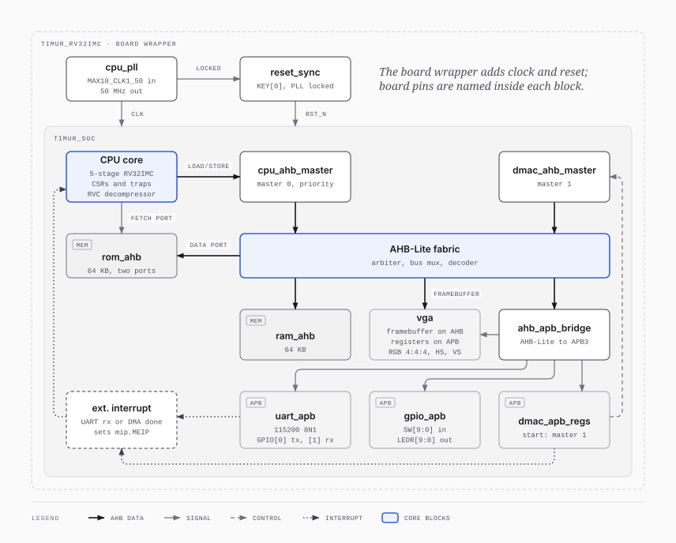</p>

<p align="center">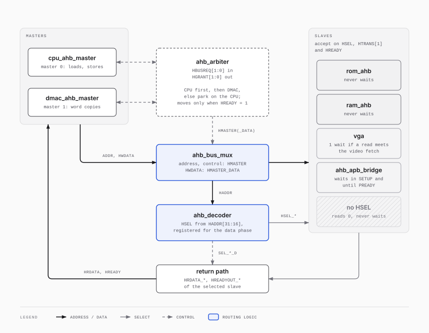</p>

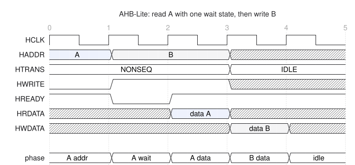

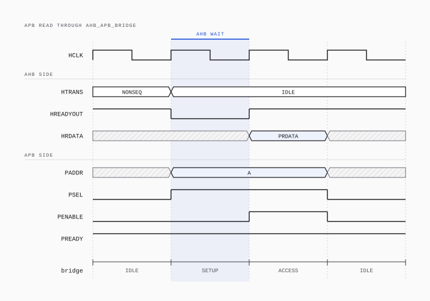

The board wrapper `Timur_RV32IMC` contains only `cpu_pll`, the reset gating (button AND PLL locked), `reset_sync` and `timur_soc`. Testbenches instantiate `timur_soc` and drive its clock and reset directly.

---

## ISA Support

| Extension | Description | Status |
| --------- | ----------- | ------ |
| **RV32I** | Base integer instructions; FENCE, FENCE.I and WFI execute as NOPs | ✅ Phases 2–7 |
| **RV32M** | MUL, MULH, MULHSU, MULHU (2 cycles), DIV, DIVU, REM, REMU (35 cycles) | ✅ Phase 2 |
| **Zicsr** | CSRRW, CSRRS, CSRRC and the immediate forms, atomic in EX | ✅ Phase 10 |
| **Machine mode** | `mstatus`, `misa`, `mie`, `mtvec` (direct), `mscratch`, `mepc`, `mcause`, `mtval`, `mip`, 64-bit `mcycle`/`minstret` with read-only `cycle`/`time`/`instret`, ID CSRs; precise traps; ECALL, EBREAK, MRET; machine external interrupt | ✅ Phase 10 |
| **RV32C** | Every RV32C instruction (no F/D forms), expanded in IF; 32-bit instructions on any halfword boundary | ✅ Phase 11 |

Traps are taken in EX: the older instructions complete, the trapping one and the two younger ones are cancelled, and fetch continues at `mtvec`.

<p align="center">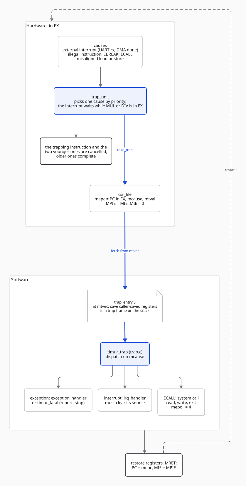</p>

| `mcause` | Cause | `mtval` |
| -------- | ----- | ------- |
| `0x8000000B` | Machine external interrupt: UART `rx_valid` with `rx_irq_enable`, or DMAC done with `irq_enable`; taken when `mstatus.MIE` and `mie.MEIE` are set and no MUL or DIV is in EX | 0 |
| 2 | Illegal instruction, including `0x0000`/`0x00000000` (the fill of unused ROM), reserved 16-bit encodings, unimplemented CSRs and writes to read-only CSRs | 0 |
| 3 | EBREAK, C.EBREAK | PC |
| 11 | ECALL | 0 |
| 4 | Misaligned load: LW not on a 4-byte boundary, LH/LHU at an odd address | address |
| 6 | Misaligned store: SW, SH as above | address |

A trap saves the PC in `mepc` and `MIE` in `MPIE`, and clears `MIE`; MRET returns to `mepc` and restores `MIE`. With the C extension every branch and jump target is 2-byte aligned, so instruction-address-misaligned (cause 0) cannot occur. `misa` reads `0x40001104` (RV32IMC).

---

## Current Status

**Phases 1–13 implemented, verified in simulation and running on the DE10-Lite; timing closed at 50 MHz. Phase 13 (VGA output) compiles in Quartus and drives an external VGA monitor on the board; its resource and timing numbers are still to be re-measured.**

| Phase | Description | Status |
| ----- | ----------- | ------ |
| 1 | Primitives and verification infrastructure | ✅ Simulation |
| 2 | Execution datapath | ✅ Simulation |
| 3 | State and memory | ✅ Simulation |
| 4 | Decode and control | ✅ Simulation |
| 5 | Single-cycle integration | ✅ Simulation (superseded by the pipeline) |
| 6 | Five-stage pipeline | ✅ Simulation |
| 7 | Hazard resolution | ✅ Simulation |
| 8 | APB peripherals | ✅ Simulation |
| 9 | AHB fabric and system | ✅ Simulation |
| 10 | CSRs, traps, machine mode | ✅ Simulation |
| 11 | C extension | ✅ Simulation |
| 12 | C software layer | ✅ Simulation (C programs run on the SoC in `timur_sw_tb`) |
| 13 | VGA output | ✅ Simulation (`vga_tb`, `sw/tests/vga.c`) and board (external VGA monitor) |

Full compile of the RV32IMC design with Quartus Prime 25.1std (Standard Edition; the Lite Edition supports the same device), `OPTIMIZATION_MODE "HIGH PERFORMANCE EFFORT"` and physical synthesis (combinational, register duplication, retiming), three fitter seeds:

| Seed | Setup slack, Slow 1200mV 85C | Fmax | Worst hold slack (Fast 1200mV 0C) |
| ---- | ---------------------------- | ---- | --------------------------------- |
| 1 (default) | +0.960 ns | 52.52 MHz | +0.156 ns |
| 2 | +0.943 ns | 52.47 MHz | +0.161 ns |
| 3 | +0.725 ns | 51.88 MHz | +0.160 ns |

Resources: 5,848 logic elements (12 %), 128 of 182 M9K blocks (1,048,576 bits: the two ROM banks and the four RAM byte lanes), 8 embedded multiplier 9-bit elements. The critical path runs from a RAM load in WB through the load formatter and the forwarding mux into the branch comparator's carry chain, then through the fetch decision into the ROM bank address registers (see [Pipeline Design](#pipeline-design)).

On the board (DE10-Lite, 30 September 2026): the shipped program (LEDs 42), bring-up 1–4 (LEDs and switches, UART transmit, DMA checksum), and the C programs `hello`, `selftest` (all 255 checks, built with and without the C extension), `traps` and `io` (console input and interrupts), with the UART connected to the PC through an ESP32-S3 used as a USB-to-serial bridge.

VGA on the board (DE10-Lite, 14 October 2026): the design with the framebuffer compiles in Quartus, and `apps/vga_demo.c` and `apps/showcase.c` run with an external monitor on the VGA connector at 640×480, 60 Hz; the picture is correct.

Still open:

- riscv-arch-test RV32IMC and Zicsr suites (RISCOF flow).
- Resource and timing numbers with VGA (Phase 13): the framebuffer adds 40 M9K blocks (about 168 of 182 expected) and one input to the AHB read-data mux; the design works on the board, but the numbers above predate it and must be re-measured.

### Not supported

Left out on purpose, to keep the design small:

| Feature | Instead |
| ------- | ------- |
| User mode, supervisor mode, PMP | Machine mode only |
| Timer and software interrupts (`mtime`, `mtimecmp`, `msip`) | One machine external interrupt: UART receive or DMA done |
| Vectored `mtvec` | Direct mode; `trap.c` dispatches on `mcause` |
| F, D, A extensions | Floating point in software (`--extra=-Wl,-u,_printf_float` for `%f`) |
| FENCE, FENCE.I, WFI semantics | Executed as no-operations (one in-order hart, no caches) |
| Bus locking (HLOCK) | The DMA engine keeps its data if it loses the bus between read and write |
| Caches, external SDRAM | 64 KB ROM and 64 KB RAM in on-chip M9K memory |

---

## Module Structure

What each phase added, module by module. Each RTL file starts with a header comment that describes its interface and behaviour in more detail.

<details>
<summary>Show the module list (phases 1 to 13)</summary>

### Phase 1 — Primitives and Verification Infrastructure

- **`mux2`, `mux4`** — parameterised multiplexers (default `WIDTH` 32).
- **`d_ff`** — D flip-flop with enable and asynchronous active-low reset.
- **`reset_sync`** — two-flop reset synchroniser: asynchronous assertion, release on the second rising edge.
- **`cpu_pll`** — ALTPLL (50 MHz in, `c0` 50 MHz out, `areset` and `locked` used). Added to the project through `cpu_pll.qip`; `cpu_pll_bb.v` is excluded from synthesis and simulation.
- **`run_tests.tcl` / `run_tests.bat`** — ModelSim regression runner (see [Simulation](#simulation)); `Timur_RV32IMC.sdc` — timing constraints.

### Phase 2 — Execution Datapath

- **`adder_32bit`** — add/subtract; B is inverted with an XOR against `sub`, which is also the carry-in (carried in an extra low bit, so the sum is one carry chain). Outputs `cout` (1 = no borrow) and signed `overflow`.
- **`barrel_shifter`** — a left and a right shifter side by side, each five cascaded `mux2` stages (one `shamt` bit per stage); a final `mux4` on `shift_type` picks the result. Every stage is one 2:1 mux deep. The right shifter fills with the original `in[31]` for SRA.
- **`multiplier`** — two cycles: both operands are extended to 33 bits with a sign bit or zero, and one signed 33×33 multiply serves MUL, MULH, MULHSU and MULHU. `start` registers the extended operands in the first EX cycle (the embedded multipliers' input registers) and the product is formed from them in the second, so late forwarded load data never passes through the multiply array in the same cycle. `done` is a level held until `ack`, as in the divider.
- **`divider`** — restoring divider, 32 iterations; divide by zero and `0x80000000 / -1` take a fast path. The DIV sits in EX for 35 cycles (2 on the fast path). `done` is a level held until `ack` (the DIV leaving EX), so it is never lost in a bus freeze.
- **`alu`** — 5-bit `ALUControl` including SLTU (`01100`); shift type decoded explicitly; `zero` computed after the result mux. The multiplier and the divider are started with `mul_start` / `div_start` and acknowledged with `mul_ack` / `div_ack` from the hazard unit.
- **`branch_condition_evaluator`** — decides BEQ, BNE, BLT, BGE, BLTU, BGEU from two compare results, `equal` and `less`. The pipeline instantiates it three times with constant inputs (equal, less, greater) and lets the late compare results pick one decision (see [Pipeline Design](#pipeline-design)).

### Phase 3 — State and Memory

- **`pc`** — 32-bit `d_ff`, enable = `pc_load`; all next-PC selection lives outside it.
- **`registers`** — 32×32 array `regs` in logic, asynchronous reads, x0 forced to 0 through a `mux2` per port, and a write-through bypass: a same-cycle WB write is returned on the read ports.
- **`rom_ahb`** — 64 KB as two 16384×16 banks: LO holds the halfwords at byte offsets 0 mod 4, HI those at 2 mod 4 (`ram_init_file` `rom_lo.mif` / `rom_hi.mif` for synthesis; zero fill plus `rom_lo.hex` / `rom_hi.hex` in simulation). Fetch port: the 32 bits at byte address A are LO[(A + 2) >> 2] and HI[A >> 2], ordered by A[1], so any halfword-aligned window — a 16-bit instruction or a 32-bit one straddling two words — is read in one cycle. AHB port: `{HI[w], LO[w]}` for loads and DMAC reads (writes ignored).
- **`ram_ahb`** — four 16384×8 byte lanes; synchronous read in the address phase, write in the data phase on the enabled lanes, read-after-write bypass for a load right behind a store to the same word, raw 32-bit `HRDATA`.
- **AHB-Lite slave convention** — every slave has an `HREADY` input and an `HREADYOUT` output and accepts an address phase only with `HSEL & HTRANS[1] & HREADY`.
- **`store_aligner`** (MEM) and **`load_formatter`** (WB) — byte/halfword replication for stores, lane selection and sign/zero extension for loads. `HSIZE` carries only the size.

### Phase 4 — Instruction Decode and Control

- **`instr_parser`** — field slicing (`opcode`, `rd`, `funct3`, `rs1`, `rs2`, `funct7`).
- **`imm_gen`** — I, S, B, U, J immediates (bit 0 of B and J is 0).
- **`alu_decoder`** — uses opcode bit 5 (`op5`): for I-type arithmetic `funct7` holds immediate bits, so `ADDI x1, x0, -5` stays ADD and `ADDI x1, x0, 40` does not become MUL.
- **`main_control_unit`** — `RegWrite`, `ALUSrcA` (rs1 / PC / zero), `ALUSrcB`, `ALUOp`, `MemRead`, `MemWrite`, `MemToReg`, `Branch`, `Jump`, `Jalr`, `CSRAccess`, `CSROp`, `CSRImm`, `IsECALL`, `IsEBREAK`, `IsMRET`, `Illegal`. SYSTEM is decoded on the full `funct12` (ECALL, EBREAK, MRET, WFI as NOP); FENCE and FENCE.I are NOPs; reserved encodings raise `Illegal` and force every side-effect control to 0.

### Phases 5–7 — Pipeline and Hazard Resolution

The datapath lives in **`timur_soc`**:

- **Fetch** — IF computes PC + 2 and PC + 4. Bits [1:0] of the fetch window tell a 16-bit instruction (expanded by the `decompressor`) from a 32-bit one and pick the sequential next PC. The ROM bank addresses are an index triple {LO index, HI index, A[1]}, computed separately for every candidate — hold, PC + 2, PC + 4, the redirect target and `mtvec` — and the final mux picks one; reset forces address 0. The ROM registers the same address as the PC register, so the fetch window always belongs to the current PC and is re-read while the PC holds.
- **`if_id_reg`, `id_ex_reg`, `ex_mem_reg`, `mem_wb_reg`** — common interface (`clk`, `rst_n`, `enable`, `flush`) and a `valid` bit; priority reset → flush (bubble) → hold → capture. A bubble has every side-effect control 0; in IF/ID it holds the NOP `0x00000013`. IF/ID and ID/EX also carry `is_compressed`.
- **EX** — forwarding muxes, `ALUSrcA`/`ALUSrcB`, ALU, branch compare and evaluation, targets, CSR access, trap decision, redirect, result mux (PC + 2 or PC + 4 for JAL/JALR links, the CSR's old value for CSR instructions).
- **MEM / WB** — the AHB address phase is issued in MEM and the data phase completes in WB; MEM/WB does not capture load data.
- **`forwarding_unit`** — 00 ID/EX value, 01 WB value, 10 EX/MEM result; EX/MEM wins; never for x0.
- **`hazard_detection_unit`** — produces every enable and flush; see [Hazard Handling](#hazard-handling).

### Phase 8 — APB Peripherals

- **`gpio_apb`** — GPIO_OUT (LEDs), GPIO_IN (switches through a two-flop synchroniser), GPIO_DIR.
- **`uart_apb`** — 8N1 UART with a fixed divider (433 → 115,207 baud at 50 MHz); transmitter and receiver time each bit from the start of the frame, the receiver samples at bit centres, rejects glitches and framing errors, and reports `rx_overrun`; `irq` = `rx_valid` AND `rx_irq_enable`.
- **`dmac_apb_regs`** — SRC, DST, LEN, CTRL (self-clearing start, `irq_enable`), STATUS (engine busy, sticky done); `irq` = done AND `irq_enable`.

### Phase 9 — AHB Bus Fabric and System

- **`cpu_ahb_master`** — AHB master 0: NONSEQ address phase from MEM (`HBURST` SINGLE, `HPROT` 0011), `HWDATA` loaded when the address phase is accepted and held through wait states, `bus_wait` for a pending address or data phase.
- **`ahb_arbiter`** — at each rising edge with `HREADY = 1`: CPU requesting → CPU; else DMAC requesting → DMAC; else park on the CPU. Outputs `HMASTER`, `HMASTER_DATA` (data-phase owner) and `HGRANT`. No HLOCK.
- **`ahb_bus_mux`** — address/control from `HMASTER`, `HWDATA` from `HMASTER_DATA`.
- **`ahb_decoder`** — `HSEL` from `HADDR[31:16]`; `HRDATA`/`HREADY` multiplexed with a data-phase select registered when `HREADY = 1`; default slave (reads 0, writes ignored).
- **`ahb_apb_bridge`** — IDLE → SETUP → ACCESS, one wait state per APB access, APB decode on `PADDR[15:8]`, back-to-back APB transfers.
- **`dmac_ahb_master`** — IDLE, RD_ADDR, RD_DATA, WR_ADDR, WR_DATA, DONE; word copies from ROM or RAM to RAM; `LEN = 0` finishes at once; keeps its data if the CPU takes the bus between the read and the write.
- **`Timur_RV32IMC`** — board wrapper: `clk_50mhz`, `rst_btn_n`, `sw[9:0]`, `leds[9:0]`, `uart_tx`, `uart_rx`.

### Phase 10 — CSRs, Traps and Machine Mode

- **`csr_file`** (`rtl/csr/`) — the machine-mode CSRs listed under [ISA Support](#isa-support). Reads are combinational (the old value goes to rd); writes, trap entry, MRET and the counters update on the clock edge. The pipeline raises `csr_we` only in the cycle in which the CSR instruction leaves EX, so an instruction held in EX by a bus freeze writes exactly once. SET and CLEAR with rs1 = x0 (or uimm = 0) do not write. Legality comes from `csr_write_attempt`, not from the final write enable, which keeps the trap decision out of a combinational loop. `mcycle` counts every cycle and `minstret` every instruction that leaves WB; a write to either half replaces it for that cycle.
- **`trap_unit`** (`rtl/csr/`) — decides whether the instruction in EX traps and with which cause and `mtval` (table under [ISA Support](#isa-support)). The misalignment check uses a separate 2-bit adder on the address's low bits. An interrupt is held off while a MUL or DIV is in EX, so a multi-cycle operation never has to be restarted.
- **In `timur_soc`** — a trap redirects fetch to `mtvec` and cancels the instruction in EX and the two younger ones; `mepc` is the PC of the instruction in EX. MRET is an ordinary redirect to `mepc`. The external interrupt line is UART `irq` OR DMAC `irq`.

### Phase 11 — C Extension

- **`decompressor`** (`rtl/decode/`) — every RV32C instruction to its RV32I equivalent, between the fetch window and IF/ID, so decode and everything after it see only 32-bit instructions. Illegal and reserved encodings (`0x0000`, C.ADDI4SPN with a zero immediate, C.LWSP with rd = 0, C.JR with rs1 = 0, C.ADDI16SP and C.LUI with a zero immediate, the F/D forms, the RV64 C.SUBW/C.ADDW slots, RV32 shifts with shamt[5] = 1) expand to `0x00000000`, which decode flags as illegal; HINT encodings are legal. Checked against the GNU toolchain for all 49,152 16-bit encodings.
- **Split-bank ROM** — see `rom_ahb` under Phase 3.
- **In `timur_soc`** — `is_compressed` travels to EX, where the link value is PC + 2 or PC + 4. Branch and JALR targets, and `mepc`, may be on any halfword.

### Phase 12 — C Software Layer

- **`sw/runtime/`** — the C runtime: memory layout (`linker.ld`), startup code (`crt0.S`), trap entry (`trap_entry.S`), UART driver (`uart.c`), newlib system calls (`syscalls.c`), trap dispatch (`trap.c`); headers in `sw/runtime/include/` (`timur.h`, `timur_defs.h`).
- **`sw/build.py`** — compile, link, check and convert a C program; **`sw/bin2mem.py`** — the binary-to-memory converter. See [C Software Layer](#c-software-layer).
- **`sw/tests/`** — C programs run on the SoC by `tb/timur_sw_tb.v`.

### Phase 13 — VGA Output

- **`vga`** (`rtl/periph/`) — 640×480 at 60 Hz with a pixel every second clock (25 MHz from the 50 MHz clock, one clock domain); 800×525 total, syncs active low. A 320×240 framebuffer of 4-bit pixels (38,400 bytes in four 9600×8 byte lanes) is an AHB slave at `0x3000_0000` with byte, halfword and word access as in `ram_ahb`; each framebuffer pixel is shown as 2×2 screen pixels through a 16-entry palette of 12-bit colours. Registers on APB at `0x4000_0300` (see [VGA](#vga)): CTRL (enable), STATUS (vertical blank), SCROLL (framebuffer row shown at the top, for scrolling without copying), FRAME (frame counter), PALETTE.
- **Shared read port** — each lane is a simple dual-port memory: the AHB data phase writes, and one read port serves both the video and AHB reads. The video fetches one word (8 pixels) per 32 clocks, in a fixed slot one word ahead; an AHB read whose address phase meets that slot waits one cycle (`HREADYOUT = 0`). Writes never wait.
- **In `timur_soc`** — `HSEL_VGA` for `HADDR[31:16] = 0x3000` in `ahb_decoder`, APB page `0x03` in `ahb_apb_bridge`, the `vga_r/g/b[3:0]`, `vga_hs`, `vga_vs` outputs. The DMAC can copy straight into the framebuffer.
- **Software** — `sw/runtime/vga.c` (pixels, rectangles, images, characters, a 40×30 console that `printf` writes to after `vga_console_init`), `sw/runtime/vga_font.c` (an 8×8 font drawn in `sw/gen_font.py`), `sw/img2vga.py` (PNG to a C header).

</details>

---

## Address Map

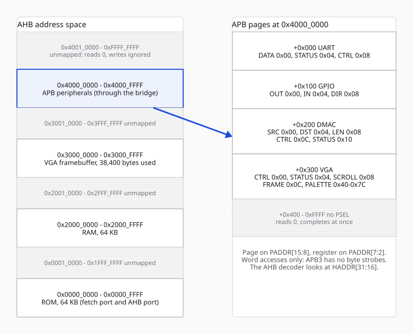

| Range | Slave | Size | Notes |
| ----- | ----- | ---- | ----- |
| `0x0000_0000 – 0x0000_FFFF` | ROM | 64 KB | Fetch port (IF) + AHB data port (loads, DMAC reads) |
| `0x2000_0000 – 0x2000_FFFF` | RAM | 64 KB | `.data`, `.bss`, heap, stack; DMAC destination |
| `0x3000_0000 – 0x3000_95FF` | VGA framebuffer | 37.5 KB | 320×240 pixels of 4 bits; `0x3000_9600 – 0x3000_FFFF` read 0, writes ignored; DMAC destination |
| `0x4000_0000 – 0x4000_00FF` | UART (APB) | 256 B | DATA `0x00`, STATUS `0x04`, CTRL `0x08` |
| `0x4000_0100 – 0x4000_01FF` | GPIO (APB) | 256 B | OUT `0x00`, IN `0x04`, DIR `0x08` |
| `0x4000_0200 – 0x4000_02FF` | DMAC registers (APB) | 256 B | SRC `0x00`, DST `0x04`, LEN `0x08`, CTRL `0x0C`, STATUS `0x10` |
| `0x4000_0300 – 0x4000_03FF` | VGA registers (APB) | 256 B | CTRL `0x00`, STATUS `0x04`, SCROLL `0x08`, FRAME `0x0C`, PALETTE `0x40`–`0x7C` |
| anything else | default slave | — | Reads 0, writes ignored |

APB3 has no byte strobes: peripheral registers are word-write only (a byte or halfword store writes the replicated value to the whole register), and registers are decoded on `PADDR[7:2]`.

---

## Pipeline Design

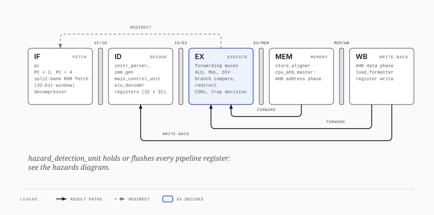

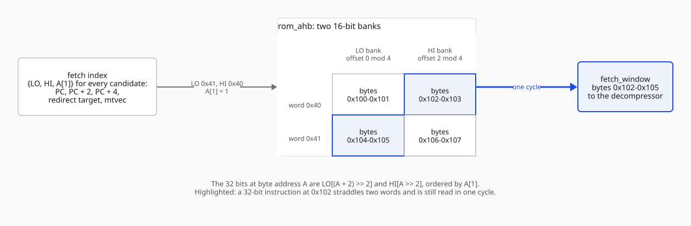

| Stage | Work | Memory / bus |
| ----- | ---- | ------------ |
| IF | Select the next PC (PC + 2, PC + 4, redirect target, `mtvec`), read the 32-bit window at the PC, expand a 16-bit instruction | ROM fetch port |
| ID | Parse, immediate, control, ALU decode, register read with WB bypass, load-use detection | — |
| EX | Forwarding, operand select, ALU, multiplier, divider, branch compare and evaluation, targets, CSR access, trap decision, redirect, result select | — |
| MEM | Store alignment; AHB address phase for loads and stores | AHB address phase |
| WB | AHB data phase, load formatting, write-back | AHB data phase |

Taken branches, JAL, JALR and MRET redirect from EX and kill exactly the two younger instructions; a trap does the same towards `mtvec` and also cancels the instruction in EX. The decision ends at the ROM bank address registers in the same cycle, so it is the longest path in the design. What keeps it within 20 ns:

- The branch compare has its own subtractor on the forwarded operands. Signed and unsigned "less" come from the same subtraction: for signed compares both sign bits are inverted first.
- Three `branch_condition_evaluator`s with constant inputs precompute the redirect for each compare outcome (equal, less, greater); the late `equal` and `less` results only select one. The fetch decision `fetch_go` (redirect or trap, and not frozen by the bus) is precomputed the same way.
- The targets have their own adders (PC + imm for branches and JAL, rs1 + imm for JALR). Each target's ROM index triple is computed from the target's low bits (target + 2 for the LO bank) in parallel with those adders, and the fetch mux takes `fetch_go` as its last select.
- Trap priority is applied on the data side (`mtvec` replaces the redirect target), not as another select level.
- `(* keep = 1 *)` on the compare results, the precomputed decisions and the index muxes stops synthesis from merging them back into one deeper cone.

---

## Hazard Handling

<p align="center">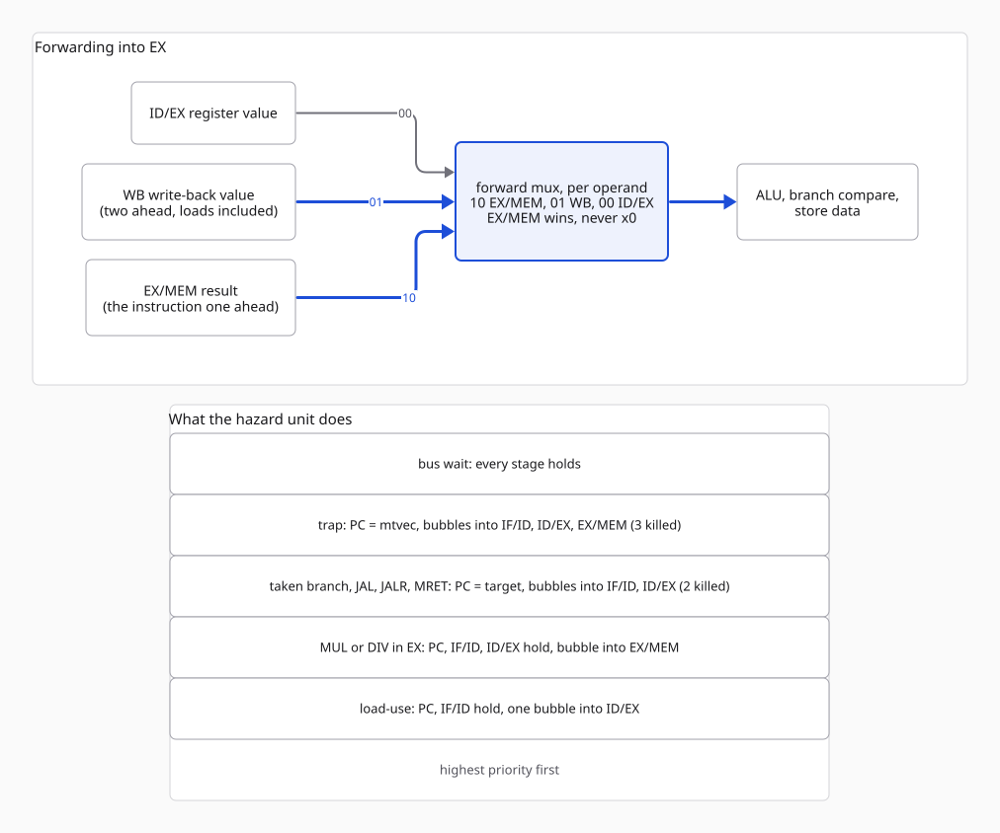</p>

| Condition (highest first) | PC | IF/ID | ID/EX | EX/MEM | MEM/WB |
| ------------------------- | -- | ----- | ----- | ------ | ------ |
| Bus wait (freeze) | hold | hold | hold | hold | hold |
| Trap or interrupt | `mtvec` | bubble | bubble | bubble | advance |
| Redirect taken (branch, JAL, JALR, MRET) | target | bubble | bubble | advance | advance |
| MUL / DIV EX stall | hold | hold | hold | bubble | advance |
| Load-use | hold | hold | bubble | advance | advance |
| Normal | PC + 2 or PC + 4 | advance | advance | advance | advance |

- **Bus wait** — CPU address phase not granted or not ready, or CPU data phase with `HREADY = 0` (for example the one wait state of every APB access, or the DMAC owning the bus).
- **Trap** — taken in EX; the trapping instruction never reaches MEM, so a misaligned access never reaches the bus. An interrupt waits while a MUL or DIV is in EX.
- **Multiplier** — `mul_start = MUL in EX AND NOT done AND NOT bus_wait` registers the operands; EX stall while `NOT done` (exactly one cycle outside a bus freeze); `mul_ack` when the MUL leaves EX.
- **Divider** — `div_start = DIV in EX AND NOT busy AND NOT done AND NOT bus_wait`; EX stall while `NOT done`; `div_ack` when the DIV leaves EX.
- **Load-use** — a load in EX whose `rd` (≠ x0) matches `rs1` or `rs2` of the instruction in ID: one bubble; the value then arrives by WB forwarding.
- Instruction fetch never waits for the bus.

---

## Peripherals

### GPIO

| Offset | Register | Access | Description |
| ------ | -------- | ------ | ----------- |
| `0x00` | GPIO_OUT | R/W | Drives `LEDR[9:0]` |
| `0x04` | GPIO_IN | R | `SW[9:0]` through a two-flop synchroniser |
| `0x08` | GPIO_DIR | R/W | Reserved for header pins |

### UART

| Offset | Register | Access | Description |
| ------ | -------- | ------ | ----------- |
| `0x00` | UART_DATA | R/W | Write: byte to send (ignored while `tx_busy`). Read: received byte; clears `rx_valid` and `rx_overrun` |
| `0x04` | UART_STATUS | R | bit 0 `tx_busy`, bit 1 `rx_valid`, bit 2 `rx_overrun` |
| `0x08` | UART_CTRL | R/W | bit 0 `rx_enable`, bit 1 `rx_irq_enable` |

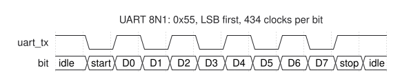

All UART registers reset to 0, so the receiver starts disabled; software sets `rx_enable` before the first read. With `rx_irq_enable` set, the UART requests the machine external interrupt while `rx_valid` is 1; reading UART_DATA clears it. The DE10-Lite has no USB-UART bridge: connect a **3.3 V** USB-to-TTL adapter (FT232R, CP2102 or CH340) to the GPIO header — see [Building & Programming](#building--programming).

### DMAC

| Offset | Register | Access | Description |
| ------ | -------- | ------ | ----------- |
| `0x00` | DMAC_SRC | R/W | Source byte address (word-aligned): ROM or RAM |
| `0x04` | DMAC_DST | R/W | Destination byte address (word-aligned): RAM or the VGA framebuffer |
| `0x08` | DMAC_LEN | R/W | Number of 32-bit words; 0 = no transfer, done set at once |
| `0x0C` | DMAC_CTRL | R/W | bit 0 start (self-clearing, ignored while busy), bit 1 `irq_enable`; any write clears done |
| `0x10` | DMAC_STATUS | R | bit 0 busy, bit 1 done (sticky) |

With `irq_enable` set, the DMAC requests the machine external interrupt while done is 1; any CTRL write clears done. Typical use: copy the `.data` section from ROM to RAM at boot, the hardware version of the `crt0` copy loop, or a picture from ROM into the VGA framebuffer.

### VGA

| Offset | Register | Access | Description |
| ------ | -------- | ------ | ----------- |
| `0x00` | VGA_CTRL | R/W | bit 0 `enable` (resets to 1); 0 = black picture, syncs keep running |
| `0x04` | VGA_STATUS | R | bit 0 `vblank`: the beam is in the vertical blanking interval (lines 480–524) |
| `0x08` | VGA_SCROLL | R/W | Framebuffer row shown at the top of the screen, 0–239 (writes of 240 or more are ignored); the rows below it follow and wrap |
| `0x0C` | VGA_FRAME | R | Frames started, counted at the start of each vertical blanking interval |
| `0x40`–`0x7C` | VGA_PALETTE[0..15] | R/W | 12-bit colour `0xRGB` of pixel value 0–15; resets to the 16 standard VGA text-mode colours (0 black, 1 blue, … 15 white) |

<p align="center">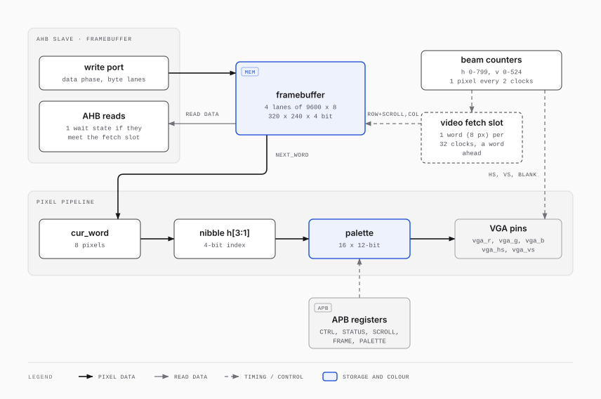</p>

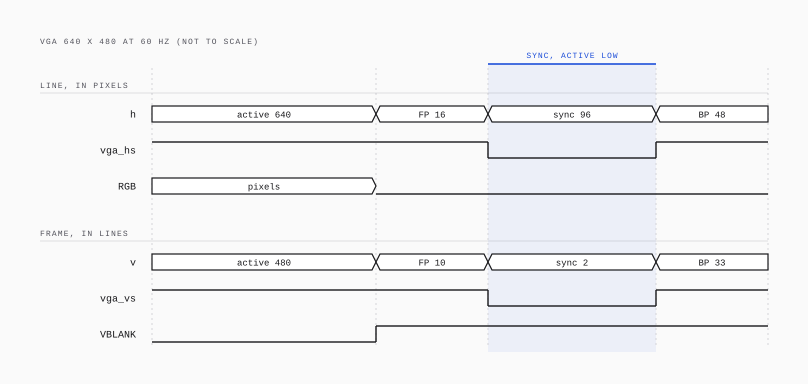

The framebuffer at `0x3000_0000` holds row *y* at byte 160·*y*; each byte holds two pixels, the left one in its low nibble, so a 32-bit word is eight pixels with the leftmost in bits 3:0. The picture is 640×480 at 60 Hz (25 MHz pixel rate, 25.175 MHz nominal), each framebuffer pixel shown as 2×2 screen pixels, on the DE10-Lite's 4-bit resistor DACs. Draw while `vblank` is 1 (or after FRAME changes) to avoid tearing. A framebuffer read that coincides with the video fetch takes one extra cycle; writes never wait.

---

## Tool Stack

| Purpose | Tool |
| ------- | ---- |
| HDL | Verilog-2001 |
| Synthesis, fitting, timing | Quartus Prime 25.1std (Standard Edition used for the numbers above; the Lite Edition supports the 10M50), Timing Analyzer with `Timur_RV32IMC.sdc` |
| Simulation | ModelSim-Intel FPGA Starter Edition 2020.1 (standalone), driven by `run_tests.tcl`; Questa-Altera FPGA Starter Edition or Icarus Verilog 13 are acceptable replacements |
| PLL | ALTPLL via the IP Catalog (`cpu_pll.v` + `cpu_pll.qip`) |
| Memory initialisation | `rom_lo.mif` / `rom_hi.mif` (synthesis), `rom_lo.hex` / `rom_hi.hex` (simulation) and `rom.hex` (32-bit words, testbenches), all from the same program |
| Test programs | Python 3.10+, standard library only: `sw/gen_soc_tests.py` (system tests), `sw/gen_sw_tests.py` (C programs), `sw/gen_unit_vectors.py` (CSR file, trap unit), `sw/gen_decompressor_vectors.py` (decompressor), `sw/gen_font.py` (VGA console font), on the package `sw/timur_tools/` (assembler, RV32IMC reference model, vector writer, PNG reader) |
| Diagrams | Hand-drawn inline SVG, one HTML page per diagram in `docs/diagrams/src/` (open it in a browser to edit); `make diagrams` exports the committed SVGs in `docs/diagrams/` with the standard library only. Shared palette and rules: the diagram-design skill's `timur` profile (`.diagram-design`) |
| Checks | ruff, mypy, pytest, clang-format, clang-tidy, cppcheck, shellcheck (`requirements-dev.txt`), GCC `-fanalyzer`; see [Development and Checks](#development-and-checks) |
| Software | xPack `riscv-none-elf-gcc` 14.2.0-3 (GCC 14.2, newlib-nano) |
| On-chip debug | Signal Tap Logic Analyzer |

---

## Simulation

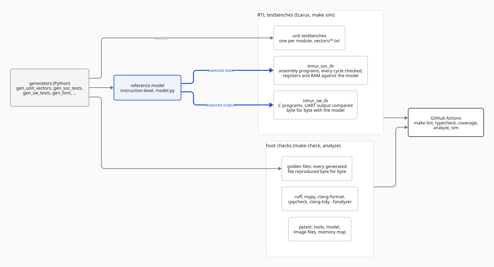

### Running all tests

`make sim` (or `./run_tests.sh`) runs the whole regression with Icarus Verilog (`sudo dnf install iverilog`, or set `IVERILOG` and `VVP`): it compiles each testbench with the RTL (without `cpu_pll` and the board wrapper, which need the Altera megafunction library; `timur_sw_tb` also gets `tb/timur_soc_tb.v`), keeps its output in `logs/<testbench>.log` and prints a summary. A testbench passes only if its log contains `ALL n TESTS PASSED` with n > 0 and no `FAIL` line, so a crash, a missing vector file or a watchdog timeout counts as a failure. `./run_tests.sh alu_tb timur_soc_tb` runs only those. A single testbench by hand:

```bash
RTL=$(ls rtl/*/*.v | grep -v -e cpu_pll -e _bb.v -e Timur_RV32IMC.v)
iverilog -g2001 -s timur_soc_tb -o sim.vvp tb/timur_soc_tb.v $RTL && vvp -n sim.vvp
iverilog -g2001 -s timur_sw_tb  -o sim.vvp tb/timur_sw_tb.v tb/timur_soc_tb.v $RTL && vvp -n sim.vvp
```

**ModelSim on Windows.** Double-click `run_tests.bat` or run it from a terminal. It changes to the project folder and starts `C:\intelFPGA\20.1\modelsim_ase\win32aloem\vsim.exe -c -do run_tests.tcl` (set `VSIM` to use another `vsim.exe`), which:

1. collects `rtl/*.v` and `rtl/*/*.v` (dropping every `*_bb.v`) and `tb/*_tb.v`;
2. deletes, recreates and maps the `work` library;
3. compiles everything once and aborts on any compile error;
4. runs each testbench through a temporary do-file (`run -all`, `quit -sim`), with its transcript in `logs/<testbench>.log`;
5. counts a test as passed only if its log contains `ALL n TESTS PASSED` with n > 0 and no `FAIL` line — a crash, a missing vector file or a watchdog timeout leaves no summary line and fails;
6. prints a summary and deletes the temporary do-files.

Paths inside testbenches (`vectors/…`, `rom_lo.hex`) are relative to the project root. `timur_sw_tb` runs about 2 million cycles and takes the longest.

### Testbench conventions

<details>
<summary>Vector files, check timing and the pass rule</summary>

- One `tb/<module>_tb.v` per module and one `vectors/<module>_vectors.txt`; lines starting with `//` are comments, and lines whose field count does not match are skipped.
- Sequential vectors end with a `wait_type` column: `0` = check 3 ns after applying inputs without a clock edge, `1` = wait for the next rising edge plus 1 ns, then check. Protocol testbenches may use `x` digits in expected values for "don't care".
- Every testbench starts with `` `timescale 1ns/1ps``, has a watchdog that prints a `FAIL` line, compares with `!==`, prints one `PASS`/`FAIL` line per vector, and ends with exactly `ALL n TESTS PASSED` or `f / n TESTS FAILED` followed by `$stop`. A run with no vectors is a failure. (`decompressor_tb` prints one summary `PASS` line for its 49,152 encodings.)

</details>

### System tests and test programs

`tb/timur_soc_tb.v` runs the programs listed in `vectors/timur_soc_vectors.txt` on `timur_soc`:

| Program | Covers |
| ------- | ------ |
| `timur_soc_phase5.hex` | The Phase 5 test program (no loads) |
| `timur_soc_phase6.hex` | Loads and stores of every size and offset, JAL/JALR links, LUI/AUIPC, register-file bypass |
| `timur_soc_phase7.hex` | Forwarding, load-use, the Phase 7 walkthrough (LW, dependent ADD, DIV, taken branch), DIV/REM (including an operand from an APB load and REM by zero after an APB load), MUL (including an operand straight from a RAM load), taken branch/JAL/JALR killing exactly two instructions — once normally and once with HREADY held low for three cycles in every RAM load |
| `timur_soc_random.hex` | Random dependency-dense program (RAM and APB loads/stores, ROM loads, DIV/REM corner cases, branches, JAL, JALR), with and without HREADY waits |
| `timur_soc_system.hex` | GPIO, UART, DMA copy while the CPU runs loads and stores, DMAC STATUS busy/done, `LEN = 0`, default slave |
| `timur_soc_phase10.hex` | Every CSR instruction form, back-to-back and forwarded CSR operands, WARL fields, counters, a CSR write during a bus freeze, every trap cause with MRET back, misaligned accesses through the base register — with and without HREADY waits |
| `timur_soc_interrupt.hex` | DMAC done interrupt held off by a chain of DIVs, then taken exactly once |
| `timur_soc_phase11.hex` | Every compressed instruction, 32-bit instructions straddling two words, PC + 2 links, 16-bit traps (assembled by GNU as) — with and without HREADY waits |
| `timur_soc_random_c.hex` | Random mix of 16-bit and 32-bit instructions, many straddling, with and without HREADY waits |
| `rom.hex` | The final cross-phase program (the default ROM image) |
| `sw/bringup/bringup_*.hex` | The three hardware bring-up programs (see [Building & Programming](#building--programming)) |

Every cycle of every program the testbench also checks that the fetch window holds the 32 bits at the PC and that IF/ID holds the instruction at its PC (the expansion of a 16-bit instruction, from a reference decompressor), that each MUL gets one multiplier start and one stall cycle, that each DIV gets exactly one divider start, that each load-use costs exactly one bubble, that no misaligned access reaches the bus and that no interrupt is taken with a MUL or DIV in EX. The programs are the assembly sources in `sw/programs/`. Expected registers, RAM words and the order in which instructions leave EX come from the reference model in `sw/timur_tools/model.py`; values that depend on timing (counters, UART and DMAC polling, interrupts) are left out of the model's checks and have hand-written ones. Add `+trace` to the simulator command line to print PC, instruction and x1–x14 every cycle.

### C programs

`tb/timur_sw_tb.v` is `timur_soc_tb` with `vectors/timur_sw_vectors.txt` and a UART of 16 cycles per bit (the programs only poll the UART's flags, so the baud rate does not change what they print). Each program in `sw/tests/` runs once built for `rv32im_zicsr` and once for `rv32imc_zicsr`; its UART output must match, byte for byte, the output of the reference model running the same image, and its exit code must appear on the LEDs. The log shows each program's output, prefixed with `  | `.

| Program | Covers |
| ------- | ------ |
| `hello.c` | `printf`, a CSR read, the switches |
| `selftest.c` | `.data`/`.sdata` initial values, `.bss`/`.sbss` zeroed, `.rodata` through the ROM's AHB port, a constructor; recursion and stack frames; `+ - * / %` including negative operands, division by zero and `INT_MIN / -1`, MULH/MULHU/MULHSU, 64-bit arithmetic and shifts; `snprintf`, `sscanf`, `strtol`, string functions, `qsort`; `malloc`/`calloc`/`realloc`, heap exhaustion returning `NULL` below the stack; ECALL system calls and register preservation; CSRs; the runtime's limits (ECALL arguments outside ROM/RAM or too long, file descriptors other than the console, `sbrk` beyond the heap). 255 checks against values computed by the compiler or defined by the M extension, also run with HREADY waits |
| `traps.c` | Exceptions handled by the program — illegal 32- and 16-bit instructions, EBREAK and C.EBREAK, misaligned LW/LH/LHU/SW/SH — with `mcause`, `mepc` and `mtval` checked, then the runtime's report of an unhandled one (LEDs `0x302`) |
| `io.c` | Console input through `fgets`, `sscanf` and `getchar`; DMA copy from ROM with the done interrupt; a masked interrupt pending in `mip.MEIP` until `MIE` is set; a line received by the UART receive interrupt. The testbench types the input on `uart_rx` |
| `vga.c` | VGA registers after reset, palette and SCROLL ranges, framebuffer stores of every size and accesses beyond its end, `vga_clear`/`vga_set_pixel`/`vga_fill_rect`/`vga_blit` checked pixel by pixel, characters against the font, a DMA copy from ROM into the framebuffer, the console (`printf` on the screen, wrap, hardware scrolling); 57 checks, also run with HREADY waits |

### Regenerating vectors and images

<details>
<summary>The generators and what they need</summary>

From any directory (the scripts find the project they are in; `--root DIR` or `TIMUR_ROOT` selects another), or all five with `make regen`:

```bash
python3 sw/gen_font.py                   # sw/runtime/vga_font.c from the glyph pictures in the script
python3 sw/gen_soc_tests.py              # system tests, rom.* (default seed 20260926); --seed N for another random program
python3 sw/gen_sw_tests.py               # C programs: builds sw/tests/*.c, runs the model, writes vectors/timur_sw_*
python3 sw/gen_unit_vectors.py           # csr_file and trap_unit vectors
python3 sw/gen_decompressor_vectors.py   # all 16-bit encodings, expanded by the GNU toolchain
```

The generated files are deterministic: `tests/host/test_golden.py` regenerates them and compares them byte for byte with the committed ones. Images compiled from C are only byte-identical with the compiler release they were built with, xPack GCC 14.2.0-3; another release produces other, equally valid images, and `gen_sw_tests.py` warns about it. `gen_decompressor_vectors.py` needs the RISC-V toolchain. `gen_soc_tests.py` needs it for the Phase 11 programs and `gen_sw_tests.py` for the C programs; without it they reuse the committed images and still regenerate the expectations.

</details>

---

## Building & Programming

1. Open `Timur_RV32IMC.qpf` in Quartus Prime 25.1std.
2. Run **Processing → Start Compilation**.
3. Check **Timing Analyzer → Slow 1200mV 85C Model → Setup Summary / Fmax Summary**: slack must be positive, with 0 illegal and 0 unconstrained clocks.
4. Check **Fitter → Resource Section → RAM Summary** for the 128 M9K blocks and **Flow Summary** for the Embedded Multiplier 9-bit elements.
5. Program the `.sof` from `output_files/` with **Tools → Programmer**.

Pins (DE10-Lite golden top, 3.3-V LVTTL):

| Port | Board signal |
| ---- | ------------ |
| `clk_50mhz` | `MAX10_CLK1_50` (PIN_P11) |
| `rst_btn_n` | `KEY[0]` (PIN_B8), active low |
| `sw[9:0]` | `SW[9:0]` |
| `leds[9:0]` | `LEDR[9:0]` |
| `uart_tx` | `GPIO[0]` (PIN_V10), header pin 1 → adapter RX |
| `uart_rx` | `GPIO[1]` (PIN_W10), header pin 2 ← adapter TX |
| `vga_r[3:0]` | `VGA_R[3:0]` (PIN_AA1, V1, Y2, Y1) |
| `vga_g[3:0]` | `VGA_G[3:0]` (PIN_W1, T2, R2, R1) |
| `vga_b[3:0]` | `VGA_B[3:0]` (PIN_P1, T1, P4, N2) |
| `vga_hs`, `vga_vs` | `VGA_HS` (PIN_N3), `VGA_VS` (PIN_N1) |

Use a 3.3 V adapter only (never 5 V) and connect its ground to a GND pin of the GPIO header. Terminal settings: 115200 8N1, no flow control; the C runtime sends CR LF for every newline and accepts CR (Enter) as the end of a line. Any monitor with a VGA input that accepts 640×480 at 60 Hz shows the VGA output; `apps/vga_demo.c` is a first test (`python3 sw/build.py --install apps/vga_demo.c`).

The ROM contents come from `rom_lo.mif` and `rom_hi.mif` in the project root. Hardware bring-up order — for steps 1–3 copy the program's `_lo.mif` and `_hi.mif` over `rom_lo.mif` and `rom_hi.mif` (and its `_lo.hex`/`_hi.hex` over `rom_lo.hex`/`rom_hi.hex` for simulation), for steps 5 and 6 run `sw/build.py --install`, then recompile:

| Step | Program | Expected on the board |
| ---- | ------- | --------------------- |
| 1 | `sw/bringup/bringup_1_gpio_lo.mif` and `_hi.mif` | LEDs mirror the switches; with every switch off they show `0x2A5` |
| 2 | `sw/bringup/bringup_2_uart_lo.mif` and `_hi.mif` | `UUUU…` in the terminal, a square wave on `uart_tx` |
| 3 | `sw/bringup/bringup_3_dma_lo.mif` and `_hi.mif` | DMA copies four ROM words to RAM; the LEDs show the checksum's low bits `0x2AA` |
| 4 | `rom_lo.mif` / `rom_hi.mif` as shipped | Final cross-phase program: LEDs show 42 (`0b00_0010_1010`), one `U` on the UART |
| 5 | `python3 sw/build.py --install sw/tests/hello.c` | `Hello from Timur RV32IMC!`, `misa`, the switch value; then LEDR9 lights (exit code 0) |
| 6 | `python3 sw/build.py --install sw/tests/selftest.c` (or `io.c`, which asks for input) | `all 255 checks passed`; LEDs `0x200` |

`python3 sw/gen_soc_tests.py` restores the shipped ROM image.

A new ROM image does not need a full compilation: after one full compilation in the project folder, **Processing → Update Memory Initialization File** followed by **Processing → Start → Start Assembler** rebuilds the `.sof` and `.pof` with the new `rom_lo.mif`/`rom_hi.mif` in a few seconds (from a terminal: `quartus_cdb Timur_RV32IMC -c Timur_RV32IMC --update_mif`, then `quartus_asm Timur_RV32IMC -c Timur_RV32IMC`). Timing does not change, since only memory contents do. `sw/program_board.sh` does all of it and programs the board: it swaps the ROM contents into the last compilation (or runs a full compilation when there is none, or when a file in `rtl/`, the `.qsf` or the `.sdc` is newer than the last fit, and stops on negative slack), then programs the `.sof` over JTAG; `--flash` programs the `.pof` into the configuration flash instead, so the design survives power-off.

---

## Using another board

Timur was built and tested on a **Terasic DE10-Lite**, and everything above describes that board. Nothing below the board wrapper depends on it: `timur_soc` and every module under it are plain Verilog-2005 with no vendor IP, so another FPGA board needs a new top-level file, a pin file and the board's own programming tool. Only the DE10-Lite has been tested on hardware; the other targets below have been checked in simulation and with Yosys synthesis.

**What the board needs**

| Need | Why |
| ---- | --- |
| A 50 MHz clock, or a PLL that makes one | `TIMUR_CLOCK_HZ`, the UART divider (115200 baud) and the VGA timing (a pixel every second clock) all assume 50 MHz |
| About 1.36 Mbit of block RAM | 64 KB ROM + 64 KB RAM + 37.5 KB VGA framebuffer |
| A push button for reset | Active low in the template; invert an active-high one |
| Optional: LEDs, switches, a 3.3 V UART, VGA with 4 bits per colour | Tie unused inputs off (`sw` to 0, `uart_rx` to 1) and leave unused outputs unconnected |

**Porting steps**

1. Copy `boards/template/timur_board_top.v` into the new project. It has the same ports as the DE10-Lite wrapper but no PLL: the clock goes straight to `reset_sync` and `timur_soc`. If the board's oscillator is not 50 MHz, add the vendor's PLL and AND its locked output into the reset, as `rtl/top/Timur_RV32IMC.v` does.
2. Add every `rtl/*/*.v` except `rtl/primitives/cpu_pll.v`, `rtl/primitives/cpu_pll_bb.v` and `rtl/top/Timur_RV32IMC.v` (the Intel PLL and the DE10-Lite wrapper).
3. Define **`TIMUR_PORTABLE`** for synthesis. It drops the Intel `ramstyle = "M9K"` hints (Yosys obeys them and fails on other FPGAs) and loads the ROM with `$readmemh` from `rom_lo.hex` and `rom_hi.hex` instead of Quartus's `.mif` files. The DE10-Lite build never defines it, so Quartus compiles exactly the same code as before.
4. Make `rom_lo.hex` and `rom_hi.hex` visible to the tool: add them to the Vivado project, or run Yosys from the repository root. `python3 sw/build.py --install prog.c` writes them as before; synthesise again after installing a new program.
5. Write the pin constraints from the board's manual, build and program.

With Yosys, for example for a Xilinx 7-series part:

```bash
RTL=$(ls rtl/*/*.v | grep -v -e cpu_pll -e Timur_RV32IMC.v | tr '\n' ' ')
yosys -p "read_verilog -DTIMUR_PORTABLE $RTL boards/template/timur_board_top.v; synth_xilinx -top timur_board_top -family xc7 -flatten"
```

In Vivado, `set_property verilog_define TIMUR_PORTABLE [current_fileset]` sets the define.

**By FPGA family**

| Board family | What changes | Fits? |
| ------------ | ------------ | ----- |
| Other Intel boards (DE0-CV, DE1-SoC, DE2-115, DE10-Nano) | Stay with Quartus, the `.mif` files and `rtl/top/Timur_RV32IMC.v`; leave `TIMUR_PORTABLE` undefined. Change the device and pins in the `.qsf` and regenerate `cpu_pll` for the new family. On Cyclone V, change the `M9K` hints to `M10K`. The DE1-SoC and DE2-115 drive VGA through an 8-bit ADV7123 DAC that also needs `VGA_CLK`, `VGA_BLANK_N` and `VGA_SYNC_N`: connect the 4-bit colours to its top bits | Yes |
| Xilinx 7-series (Basys 3, Arty A7, Nexys A7) | Template wrapper, `TIMUR_PORTABLE`, a Clocking Wizard for 100 MHz → 50 MHz, an `.xdc` pin file. The Basys 3 is the closest match: 4-bit-per-colour VGA like the DE10-Lite and a USB-UART on the board | XC7A35T: about 4,100 LUTs, 1,900 flip-flops, 4 DSPs, 41 of 50 block RAMs (Yosys) |
| Lattice ECP5 (ULX3S, OrangeCrab; Yosys + nextpnr) | Template wrapper, `TIMUR_PORTABLE`, an EHXPLLL for 50 MHz if the board clock differs, an `.lpf` pin file | 82 DP16KD block RAMs: the 45F and larger fit, the 25F (56) does not |
| Small FPGAs (iCE40, Tang Nano, ECP5-25F) | Not enough block RAM. Shrink the ROM and RAM (the address decoder, `sw/runtime/linker.ld`, `timur_defs.h` and `sw/timur_tools/memmap.py` together; `tests/host/test_memmap.py` checks they agree) or leave out the VGA | After changes |

Timing has only been closed on the MAX 10 at its slowest speed grade, which is slower than most current FPGAs, so 50 MHz should not be a problem elsewhere; check the tool's timing report all the same.

---

## C Software Layer

<p align="center">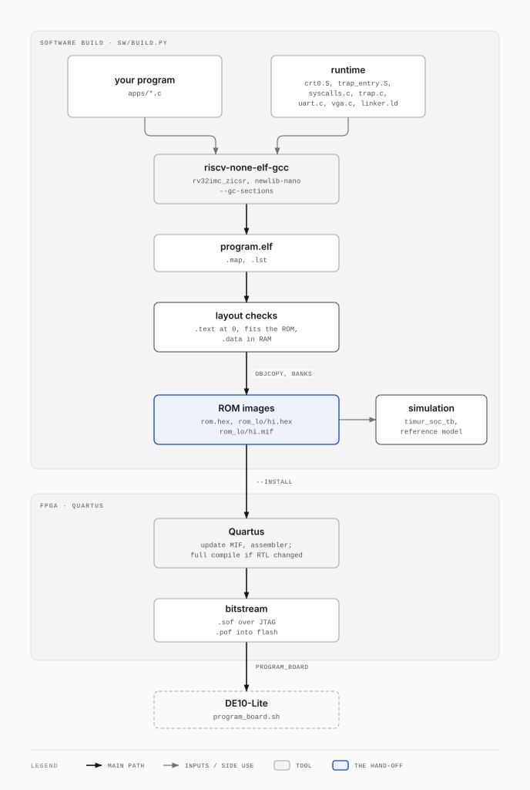</p>

| File | Role |
| ---- | ---- |
| `sw/runtime/include/timur.h` | The interface for programs: peripheral registers, CSR access macros, trap interface, system calls, raw UART driver, VGA driver (Doxygen comments) |
| `sw/runtime/include/timur_defs.h` | Memory map, register offsets and bits, CSR fields, trap causes, trap-frame layout: plain `#define`s shared by C and assembly |
| `sw/runtime/include/timur_runtime.h` | Internal: one prototype for each newlib stub, the linker-script symbols, the console hook, the font table |
| `sw/runtime/linker.ld` | Memory layout (below); `__stack_size` (default 8 KB) can be changed with `-Wl,--defsym=__stack_size=N` |
| `sw/runtime/crt0.S` | Startup code and `_halt` |
| `sw/runtime/trap_entry.S` | `trap_entry`: saves the caller-saved registers, calls `timur_trap`, MRET |
| `sw/runtime/uart.c` | Raw, polled UART driver (`uart_putc`, `uart_getc`, `uart_puts`, `uart_puthex`) |
| `sw/runtime/syscalls.c` | newlib system calls: the UART is `stdin`, `stdout` and `stderr` (output also to the VGA console after `vga_console_init`); heap for `malloc`; `_exit` |
| `sw/runtime/trap.c` | Trap dispatch: ECALL system calls, `irq_handler`, `exception_handler`, the report of unhandled traps |
| `sw/runtime/vga.c` | VGA driver: `vga_clear`, `vga_set_pixel`, `vga_get_pixel`, `vga_fill_rect`, `vga_blit`, `vga_show_image` (full screen by DMA), `vga_set_palette`, `vga_wait_vblank`, `vga_draw_char`; the 40×30 console (`vga_console_init`, `vga_putc`, `vga_puts`, `vga_set_colours`, `vga_set_cursor`) |
| `sw/runtime/vga_font.c` | The 8×8 console font, generated by `sw/gen_font.py` |
| `sw/build.py` | Compile, link, check and convert a program |
| `sw/bin2mem.py` | Binary-to-memory converter |
| `sw/run_model.py` | Run a built program on the reference model; write a vector file to run it on the RTL |
| `sw/img2vga.py` | Convert a PNG into a C header for the framebuffer: scaled (or `--keep-aspect`), reduced to 16 colours (median cut, or `--palette vga`) |

**VGA.** The driver is linked only into programs that call it. After `vga_console_init(fg, bg)`, `printf` and `puts` write to the screen as well as the UART; the console scrolls with the SCROLL register instead of copying. A picture:

```bash
python3 sw/img2vga.py photo.png -o apps/photo.h      # 320x240, 16 colours; --size WxH, --keep-aspect, --palette vga
```

```c
#include "photo.h"
for (int i = 0; i < 16; i++)
    vga_set_palette(i, photo_palette[i]);
vga_show_image(photo_pixels);                        /* or vga_blit(x, y, w, h, pixels) for smaller ones */
```

A full-screen picture takes 38,400 of the ROM's 65,536 bytes.

<p align="center">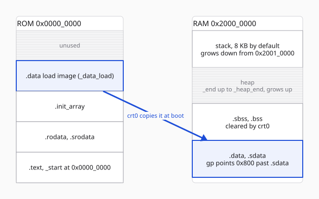</p>

**Memory layout.** ROM (`0x0000_0000`, 64 KB): `.text` from address 0 (`_start` first), `.rodata`/`.srodata`, `.init_array`, then the load image of `.data`. RAM (`0x2000_0000`, 64 KB): `.data`/`.sdata` (copied at boot), `.sbss`/`.bss` (cleared at boot), the heap from `_end` up to `_heap_end`, and the stack (`__stack_size` bytes below `_stack_top` = `0x2001_0000`). `gp` points at the small data plus `0x800`. The script asserts that the image fits in the ROM and that `.data` and `.bss` leave room for the stack.

**Startup (`crt0.S`).** Load `gp` (with linker relaxation off for that instruction), set `sp`, point `mtvec` at the 4-byte-aligned `trap_entry`, copy `.data` from ROM to RAM a word at a time, clear `.bss`, run the constructors, call `main(0, NULL)` and pass its result to `exit`, which flushes `stdout` and ends in `_exit` (should `exit` return, `_start` jumps to `_halt`).

**Console.** `_write` waits for `tx_busy` to clear before each byte and turns `\n` into `\r\n`; `_read` enables the receiver, waits for each byte, turns `\r` into `\n` and returns at the end of a line. Both wait without a timeout. `stdout` is line buffered. The console (file descriptors 0–2) is the only file: other descriptors fail with `EBADF`, and a negative length with `EINVAL`. `_sbrk` fails with `ENOMEM` instead of growing into the stack or below the start of the heap. `_exit(code)` shows `0x200 | code` on the LEDs (LEDR9 = the program has ended) and stops in `_halt`, a jump to itself.

**Traps.** `trap_entry` saves `ra`, `t0`–`t6` and `a0`–`a7` on the stack and calls `timur_trap` with interrupts disabled (the hardware cleared `MIE`):

- ECALL: system call `a7` with arguments `a0`–`a2` — 63 `read`, 64 `write`, 93 `exit`, anything else returns `-ENOSYS`. The arguments are checked first: a wrong file descriptor returns `-EBADF`, a length above `0x7FFFFFFF` `-EINVAL`, and a buffer that does not lie entirely in ROM or RAM (`write`) or in RAM (`read`) `-EFAULT`. The result goes into the saved `a0` and `mepc` advances by 4. `timur_ecall()` in `timur.h` makes the call from C.
- External interrupt: `irq_handler(mcause)`, which the program defines and which must clear the source (read UART_DATA, write DMAC_CTRL).
- Any other exception: `exception_handler(frame, mcause, &mepc, mtval)`; returning 1 resumes at the (updated) `mepc`.
- Without a handler, the runtime prints `*** unhandled trap: <cause>` with `mcause`, `mepc` and `mtval` over the UART and exits with `0x100 | cause` (LEDs `0x300 | cause`).

**Building.** `python3 sw/build.py [--march rv32im_zicsr|rv32imc_zicsr] [-O2] [--install] program.c [more.c …]` compiles with `-march=… -mabi=ilp32 -O2 -std=gnu11 --specs=nano.specs -ffunction-sections -fdata-sections -I sw/runtime/include`, links with `-nostartfiles -T sw/runtime/linker.ld -Wl,--gc-sections -Wl,-Map=…` through the `gcc` driver, and writes `sw/build/<name>/` (`.elf`, `.map`, `.lst`, `.bin`, `.hex` and the `_lo`/`_hi` banks). It stops if the C library is not the one for the chosen ISA (`-print-multi-directory` must print `rv32im/ilp32` or `rv32imc/ilp32`, never the default, which contains A-extension instructions), if `.text` does not start at 0, if `.data` does not run in RAM and load from ROM, or if the binary exceeds 64 KB. `--install` also writes `rom.hex` and `rom_lo`/`rom_hi` `.hex`/`.mif` in the project root. `--stack-size N` changes the stack reserved below the end of RAM (default 8192 bytes), and `--extra=OPTION` passes one more option to gcc after the sources: `--extra=-lm` for the maths library, `--extra=-Wl,-u,_printf_float` for `%f` in `printf` (Timur has no FPU; floating point runs in software). The runtime itself is compiled with a strict warning set (`-Wconversion`, `-Wshadow`, `-Wcast-qual`, `-Wmissing-prototypes` and more) as errors and assembled with `--fatal-warnings`; programs get `-Wall -Wextra`, and the test programs in `sw/tests/` are built with the runtime's warnings as errors. `-ffile-prefix-map` keeps the checkout location out of the program, so a build does not depend on where the project lives. The toolchain is taken from `TIMUR_TOOLCHAIN_PREFIX` (for example `/opt/riscv/bin/riscv-none-elf-`), `PATH`, or the newest release unpacked in `.tools/`. The default ISA is `rv32imc_zicsr`; `hello.c` is 6.3 KB of ROM with it and 9.5 KB without the C extension.

**Trying a program.** `python3 sw/run_model.py sw/build/<name>/<name>.elf [--input 'text\r']` runs the image on the reference model and prints its UART output, the instruction count, the LEDs and how it ended. `--vectors FILE` also writes a vector file for `tb/timur_soc_tb.v`: for a program that ends and prints nothing timing-dependent, the RTL run must reproduce the model's output byte for byte; for any other program the RTL runs it for `--cycles` cycles and shows its output (`UARTSHOW`). Run it with

```bash
iverilog -g2001 -s timur_soc_tb -o sim.vvp -Ptimur_soc_tb.UART_DIVIDER=15 \
    -Ptimur_soc_tb.VECTORS='"FILE"' tb/timur_soc_tb.v $RTL && vvp -n sim.vvp
```

The model cannot know the cycle counters and stops where one decides a branch; `--fake-time` makes them count instructions so that delay loops end.

**Converter.** `python3 sw/bin2mem.py program.bin [-o PREFIX]` writes `PREFIX.hex` (32-bit words) and the two 16-bit banks `PREFIX_lo`/`PREFIX_hi` as `.hex` and `.mif` (16384 × 16, unused entries `0000`, which decode as an illegal instruction).

**Hardware assumptions of the runtime.** One hart in machine mode (no PMP, no user mode); a 50 MHz clock; peripheral registers are 32 bits wide, accessed as words, and a store writes the whole register (APB has no byte strobes); the UART runs at 115200 8N1 with one byte of buffering in each direction, so a byte takes 4340 clock cycles and the console functions poll; traps do not nest (the hardware clears `mstatus.MIE`, and the runtime never sets it inside a handler), so `mepc`, `mcause` and `mtval` need no saving, and a trap needs 64 bytes of the interrupted stack plus what the C handlers use.

---

## Development and Checks

The C runtime, the assembly programs and the Python tools are checked by one set of commands. Set up once (Python 3.10 or newer; the tools themselves need only the standard library):

```bash
make venv            # .venv with ruff, mypy, pytest, clang-format, clang-tidy, cppcheck, shellcheck
```

| Command | What it does |
| ------- | ------------ |
| `make check` | `lint`, `typecheck` and `test`: everything that needs no simulator |
| `make lint` | `ruff check` and `ruff format --check` (Python), `clang-format --dry-run` (`sw/runtime`), `shellcheck` |
| `make format` | Apply `ruff format` and `clang-format` |
| `make typecheck` | `mypy --strict` on `sw/` and `tests/host/` |
| `make test` | `pytest tests/host`: unit tests of the assembler, the RVC expansion, the model, the image files, the builder and the CLIs, the cross-language constant check, and the golden-file test that regenerates every vector file and image and compares it byte for byte |
| `make coverage` | The same with a coverage report; fails below 90 % (currently 98 %) |
| `make analyze` | `sw/analyze.py`: GCC `-fanalyzer` with the strict warnings on the runtime and the test programs, the assembler with `--fatal-warnings`, `clang-tidy` (`.clang-tidy`) and `cppcheck` on the runtime |
| `make regen` | Run the five generators (font, unit vectors, decompressor, system tests, C programs) |
| `make sim` | `./run_tests.sh`: the RTL regression with Icarus Verilog |
| `make all` | `check`, `analyze` and `sim` |
| `make diagrams` | Export the changed diagram pages in `docs/diagrams/src/*.html` to `docs/diagrams/*.svg` |

`.github/workflows/ci.yml` runs the same targets with the pinned xPack GCC release. After changing code, keep the generated files in the same commit as the change that alters them.

**Layout of the Python tools.** The scripts in `sw/` are thin entry points (`main(argv) -> int`, `argparse`, `--root`, `--verbose`); the reusable code is the package `sw/timur_tools/`: `paths`, `memmap` (the Python copy of `timur_defs.h`), `toolchain`, `romimage`, `builder`, `isa`, `asm`, `rvc`, `model`, `randprog`, `vectors`, `cli`. Library code raises `TimurError` subclasses; only the entry points turn them into a one-line message and exit status 1 (argument errors exit with 2). Diagnostics go to stderr, results and program output to stdout.

**One set of hardware constants.** `sw/runtime/include/timur_defs.h` (C and assembly), `sw/runtime/linker.ld` and `sw/timur_tools/memmap.py` hold the same memory map, register layout and trap causes; `tests/host/test_memmap.py` checks that they agree with each other and with the RTL's address decoder and UART divider.

**Environment variables.** `TIMUR_ROOT` (project for the generators), `TIMUR_TOOLCHAIN_PREFIX` (RISC-V toolchain), `IVERILOG` and `VVP` (`run_tests.sh`), `VSIM` (`run_tests.bat`), `QUARTUS_BIN` (`program_board.sh`).

**C coding rules (MISRA-C inspired).** Fixed-width types for everything that touches hardware; `volatile` only through `TIMUR_REG`; no dynamic allocation in the runtime; every external function has one prototype in a header; the runtime compiles without warnings under the strict set. Deliberate deviations: GNU C (`-std=gnu11`) for inline assembly, statement expressions in `csr_read` and explicit register variables in `timur_ecall`; function-like macros for register and CSR access; the reserved names newlib requires (`_write`, `_sbrk`, …) and `_halt`; weak default handlers that programs override; `switch` cases that end in a `noreturn` call instead of `break`; the unbounded polling loops of the console. `.clang-tidy` lists the checks that are disabled and why.

---

## Development Phases

```text
Phase 1  ✅  Primitives and verification infrastructure
Phase 2  ✅  Execution datapath (ALU, multiplier, divider, branch evaluator)
Phase 3  ✅  State and memory (PC, register file, ROM, RAM, load/store helpers)
Phase 4  ✅  Decode and control
Phase 5  ✅  Single-cycle integration
Phase 6  ✅  Five-stage pipeline
Phase 7  ✅  Hazard resolution
Phase 8  ✅  APB peripherals (GPIO, UART, DMAC registers)
Phase 9  ✅  AHB fabric and system (arbiter, bus mux, decoder, bridge, DMA engine)
Phase 10 ✅  CSRs, traps, machine mode
Phase 11 ✅  C extension (decompressor, split-bank ROM)
Phase 12 ✅  C software layer (linker script, crt0, syscalls, trap handler, converter)
Phase 13 ✅  VGA output (controller, framebuffer, driver, console, image converter)
```

✅ = implemented, verified in simulation and on the DE10-Lite, timing closed in Quartus (see [Current Status](#current-status); the resource and timing figures there predate Phase 13 and are to be re-measured).

---

## Directory Structure

```text
Timur-RV32IMC/
├── rtl/
│   ├── primitives/   # mux2, mux4, d_ff, reset_sync, cpu_pll (+ .qip; cpu_pll_bb.v not used)
│   ├── execute/      # adder_32bit, barrel_shifter, multiplier, divider, alu, branch_condition_evaluator
│   ├── state/        # pc, registers
│   ├── memory/       # rom_ahb, ram_ahb
│   ├── decode/       # instr_parser, imm_gen, alu_decoder, main_control_unit, decompressor
│   ├── pipeline/     # if_id_reg, id_ex_reg, ex_mem_reg, mem_wb_reg, forwarding_unit,
│   │                 # hazard_detection_unit, store_aligner, load_formatter
│   ├── bus/          # cpu_ahb_master, ahb_arbiter, ahb_bus_mux, ahb_decoder, ahb_apb_bridge, dmac_ahb_master
│   ├── periph/       # gpio_apb, uart_apb, dmac_apb_regs, vga
│   ├── csr/          # csr_file, trap_unit
│   └── top/          # Timur_RV32IMC (board wrapper), timur_soc
├── boards/template/  # timur_board_top.v: vendor-neutral board wrapper for porting
├── tb/               # <module>_tb.v, one per module; timur_sw_tb.v (C programs)
├── vectors/          # <module>_vectors.txt, program images, expected UART output (.out) and input (.in)
├── sw/
│   ├── runtime/      # C runtime: linker.ld, crt0.S, trap_entry.S, uart.c, syscalls.c, trap.c, vga.c, vga_font.c
│   │   └── include/  # timur.h (programs), timur_defs.h (C and assembly), timur_runtime.h
│   ├── tests/        # C test programs
│   ├── programs/     # directed and bring-up assembly test programs (.s)
│   ├── timur_tools/  # Python package: assembler, reference model, builder, image files, ...
│   ├── build.py, bin2mem.py, run_model.py, analyze.py   # build flow, converter, model runner, static analysis
│   ├── gen_soc_tests.py, gen_sw_tests.py, gen_unit_vectors.py, gen_decompressor_vectors.py, gen_font.py
│   ├── img2vga.py                                       # PNG -> C header for the VGA framebuffer
│   ├── program_board.sh                                 # ROM image -> programming files -> board
│   └── bringup/      # hardware bring-up programs (.hex and _lo/_hi banks)
├── tests/host/       # pytest tests of the Python tools and the golden files
├── apps/             # your own programs: first.c, vga_demo.c
├── rom.hex           # default ROM image (final cross-phase program), 32-bit words
├── rom_lo.hex, rom_hi.hex, rom_lo.mif, rom_hi.mif      # the same image as the two ROM banks
├── ram.mif           # zero-filled RAM image (not used: the RAM has no initialisation file)
├── run_tests.tcl, run_tests.bat   # ModelSim regression; run_tests.sh: the same with Icarus
├── Makefile, pyproject.toml, requirements-dev.txt, .clang-format, .clang-tidy   # checks
├── docs/diagrams/     # README diagrams: SVGs; src/ holds the HTML sources (make diagrams)
├── .github/workflows/ci.yml
├── Timur_RV32IMC.qpf, Timur_RV32IMC.qsf, Timur_RV32IMC.sdc
└── README.md
```

---

## Contributing

Issues and pull requests are welcome. Before opening a pull request:

- run `make all` (lint, type checks, host tests, static analysis and the RTL regression); CI runs the same checks;
- add or update the testbench and vector file of any RTL module you change, and run `make regen` when a generator's output should change;
- follow the existing style: `make format` applies ruff and clang-format; Verilog-2001, one module per file with a header comment describing its interface.

The [Development and Checks](#development-and-checks) section lists every command.

## Support

Questions, bug reports and board-test results go to [GitHub Issues](https://github.com/hikmethankolay/Timur-RV32IMC/issues). Please include the command you ran, its output and, for RTL problems, the log from `logs/`.

---

## License

[MIT](LICENSE) © 2026 Hikmethan Kolay. Developed as an educational project.
